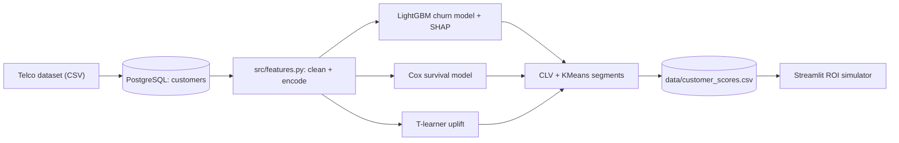

# Customer Lifetime Value and Churn Intelligence System

A telecom loses about 26.5% of its customers, and a retention discount costs money. This project answers four questions in order, then combines the answers in an ROI simulator:

1. **Who will leave?** LightGBM churn model, explained with SHAP
2. **When will they leave?** Kaplan-Meier and Cox survival models (Lifelines)
3. **Who would an offer actually change?** Uplift modeling (T-learner) on a simulated campaign
4. **Who is worth the offer?** 12-month customer lifetime value and KMeans segments

The Streamlit app lets you pick a discount, its duration, the share of customers to target and the targeting strategy, and shows expected savings against cost.

**Main finding:** predicting who will churn and deciding whom to offer a discount are different problems. The customers most likely to leave are mostly not the ones a discount can save. Targeting by uplift beat targeting by churn risk and random targeting in every setting I tested.

> **Important:** the offer campaign is **simulated** (synthetic treatment). The IBM Telco data has no real offer experiment, so the uplift results demonstrate the method and the cost structure. They are not a forecast for real customers. See [Limitations](#limitations).

## Pipeline



Each stage adds columns to one table, `data/customer_scores.csv`. The app only reads that file, so it runs without the database.

## Repository structure

```
churn-clv-system/
├── app/streamlit_app.py          ROI simulator (reads data/customer_scores.csv)
├── data/customer_scores.csv      final per-customer scores, the app's only input
├── docs/                         column_decisions.md, architecture.png, test_results.txt
├── models/                       churn_lgbm.pkl, encoded_columns.pkl
├── notebooks/
│   ├── 01_eda_churn_model.ipynb  EDA, preprocessing, baselines, LightGBM, SHAP
│   └── 02_scores_survival_uplift.ipynb   survival, uplift, CLV, segments, final table
├── reports/figures/              EDA, SHAP, Kaplan-Meier and app screenshots
├── src/                          db.py, features.py, load_data.py
├── tests/test_features.py
├── requirements.txt
└── .env.example
```

## How to run

Developed and tested on Python 3.13 (Windows).

**1. Run the app only (no database needed)**

```
pip install -r requirements.txt
streamlit run app/streamlit_app.py
```

**2. Rebuild everything from the raw data**

1. Install PostgreSQL and create a database (I used `telecom_db`).
2. Copy `.env.example` to `.env` and fill in your database details.
3. Download the IBM Telco customer churn dataset (extended version with 33 columns, Option 1 in the project brief) into `data/`.
4. Load it into PostgreSQL: `python -m src.load_data data/<your-file>`
5. Run `notebooks/01_eda_churn_model.ipynb`, then `notebooks/02_scores_survival_uplift.ipynb`. The second one writes `data/customer_scores.csv`.

**3. Run the tests**

```
python -m pytest -q
```

## Methods and decisions

**Data and leakage.** 7,043 customers, 33 columns, loaded into PostgreSQL. I kept 19 features and dropped 13 columns (reasons in `docs/column_decisions.md`). The important ones:
- `churn_reason` is filled in for exactly the 1,869 churners and blank for everyone else (verified with a crosstab), so it is only known after the customer leaves. It is used in EDA only.
- `churn_score` is IBM's own churn prediction and `cltv` is IBM's own lifetime value, so neither is used as a feature.
- `churn_label` duplicates the target.
- Location columns (zip, city, latitude, longitude) have about 4 customers per zip code, so they were left out of the baseline.

**Cleaning.** `total_charges` was stored as text with 11 blanks. All 11 customers had tenure 0 (just signed up, never billed), so I filled them with 0, not the mean. "No phone service" and "No internet service" repeat what another column already says, so they were merged into "No".

**Churn model.** Stratified 80/20 split. A dummy baseline and a scaled logistic regression were compared with LightGBM (early stopping on a validation set carved from the training data, so the test set stayed sealed). SHAP explains the model.

**Survival.** Customers who have not churned are censored, not "stayers". Duration is `tenure_months` and the event is `churn_value`. Tenure and `total_charges` are excluded from the Cox covariates because tenure is the time axis, and duplicate dummy columns were removed. Output: `exp_months_12`, the expected number of the next 12 months each customer stays active.

**Uplift.** Telco has no offer experiment, so I simulated one: the offer is assigned by coin flip, and the chance it saves a would-be churner depends on a planted rule. A T-learner (one LightGBM model on treated customers, one on control, uplift = difference in predicted churn) estimates each customer's response. Scores are computed out-of-fold (5 folds) so no customer is scored by a model that trained on them. Because choosing the top of a noisy ranking overstates the effect, I calibrated the scores to the measured effect (factor 0.559).

**CLV and segments.** CLV = monthly charges × 30% assumed margin × expected months over the next 12. KMeans (k = 4, chosen by silhouette) clusters customers on churn risk, CLV and uplift. Segment names are assigned from each cluster's profile, not its number.

## Results

### Churn model (held-out test set, 1,409 customers)

| Model | ROC-AUC | PR-AUC |
|---|---|---|
| Dummy (predicts the base rate) | 0.500 | 0.265 |
| Logistic regression (scaled) | 0.877 | 0.758 |
| LightGBM (143 trees, early stopping) | 0.890 | 0.775 |

Top SHAP drivers: contract, dependents, tenure, multiple lines, fiber optic internet. Gender shows no effect in EDA, Cox or SHAP.

### Survival

- Kaplan-Meier at 72 months: about 13% of month-to-month customers are still active, against about 57% on one-year and about 94% on two-year contracts.
- Cox hazard ratios (below 1 slows churn, above 1 speeds it up): contract 0.23, dependents 0.38, credit-card auto-pay 0.54, multiple lines 1.49, DSL 2.11 and fiber optic 2.95 (both compared with no internet).
- Sanity check (in-sample): observed churn falls from 57.6% to 2.2% across five buckets of rising expected months.

### Uplift (out-of-fold, all 7,043 customers)

| Targeting the top 20% by | Real effect of the offer (churn without offer minus churn with offer) |
|---|---|
| Predicted uplift | 0.109 |
| Churn risk | 0.053 |

Calibration check (predicted effect after the 0.559 correction vs the real effect measured with the random treatment split):

| Share targeted | Customers | Predicted | Real |
|---|---|---|---|
| Top 5% | 352 | 0.189 | 0.226 |
| Top 10% | 704 | 0.151 | 0.194 |
| Top 20% | 1,408 | 0.109 | 0.109 |
| Top 40% | 2,817 | 0.068 | 0.065 |

The 20% row matches by construction, since that is where the correction was fitted. The other rows are the real test, and small groups carry a few points of noise.

### Segments (k = 4, silhouette 0.449)

| Segment | Customers | Churn risk | 12-month CLV | Uplift |
|---|---|---|---|---|
| Loyal, high value | 2,752 | 0.132 | $294 | -0.015 |
| Low value, low risk | 2,266 | 0.095 | $101 | 0.025 |
| High risk, unresponsive | 1,125 | 0.773 | $246 | -0.008 |
| Persuadables | 900 | 0.458 | $172 | 0.241 |

Risk alone would send offers to "High risk, unresponsive" customers, who are the most likely to leave and the least likely to respond. Uplift sends them to the persuadables.

### ROI simulator: net return by setting

| Discount / months / share targeted | Highest uplift | Highest churn risk | Random |
|---|---|---|---|
| 15% / 3 / 20% (default) | -$10,398 | -$37,850 | -$33,934 |
| 15% / 2 / 20% | +$2,013 | -$21,172 | -$20,122 |
| 10% / 1 / 20% | +$9,617 | -$2,996 | -$4,206 |
| 15% / 3 / 10% | +$171 | -$24,824 | -$16,830 |
| 15% / 3 / 5% | +$2,091 | -$13,402 | -$8,039 |
| 30% / 3 / 10% | +$341 | -$49,648 | -$33,660 |
| 40% / 3 / 10% | -$11,150 | -$68,012 | -$47,448 |

How to read it:
- **Why net return is often negative.** The discount is paid to everyone targeted, but only a minority are saved. At the default, about 154 of 1,408 targeted customers are saved. Each saved customer brings about $174 of profit but costs about $242 in discounts. The campaign pays off only when cost per saved customer is below profit per saved customer.
- Uplift targeting has the best net return in every setting.
- Discount size does not change the sign up to the 30% response cap, because benefit and cost scale together. Duration and the share targeted do.

## Limitations

1. **The uplift campaign is simulated.** The result validates the method and shows how the cost structure behaves. It does not show how real Telco customers respond.
2. **CausalML did not build on Python 3.13 / Windows**, so the T-learner is implemented directly with two LightGBM models. It is the same method.
3. **`churn_prob` is partly in-sample**: the churn model trained on 80% of these customers. Use the held-out numbers above as evidence, not the app's dollar figures.
4. **Assumptions in the app:** a 30% profit margin; response grows linearly with discount up to 2x the 15% reference; the number of customers saved does not depend on how many months the discount lasts (probably optimistic for short discounts); negative predicted uplift is treated as zero (it is estimation noise, since the simulation has no negative effects).
5. **CLV covers 12 months only**, so it mostly follows the monthly bill. It correlates 0.11 with IBM's `cltv`, which uses a different method and horizon.
6. The dataset has no complaints or usage-trend columns, so `n_services` and the billing columns are the proxies.
7. The Cox proportional-hazards assumption was not tested.

## Output table: `data/customer_scores.csv`

| Column | Meaning |
|---|---|
| `customer_id` | Customer key |
| `churn_prob` | LightGBM churn probability |
| `exp_months_12` | Expected months (of the next 12) the customer stays active, from the Cox model |
| `uplift` | Out-of-fold T-learner estimate of the offer's effect (simulated campaign) |
| `uplift_cal` | `uplift` × 0.559, calibrated to the measured effect |
| `monthly_charges`, `contract` | Monthly bill and contract type |
| `clv_12m` | `monthly_charges` × 0.30 × `exp_months_12` |
| `cluster`, `segment` | KMeans cluster and its descriptive name |

## Tests

`tests/test_features.py` checks that blank `total_charges` become 0, that the "No service" values are removed, that only the chosen feature columns survive (no leaky columns), and that encoding is fully numeric and aligned to the training columns. Output is saved in `docs/test_results.txt`.

## Next steps

- Run the same T-learner on a real randomized campaign dataset (for example Hillstrom) to get a real uplift curve.
- Replace the simulated treatment with a real A/B test of the retention offer.
- Extend the CLV horizon, and test the Cox proportional-hazards assumption.
- Deploy the app.
