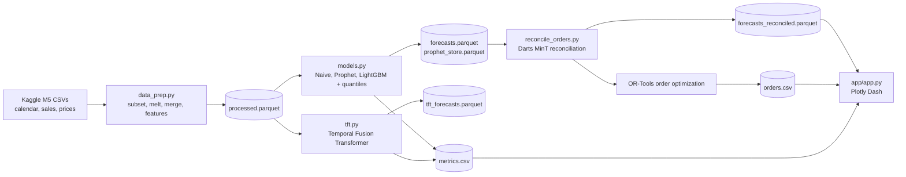
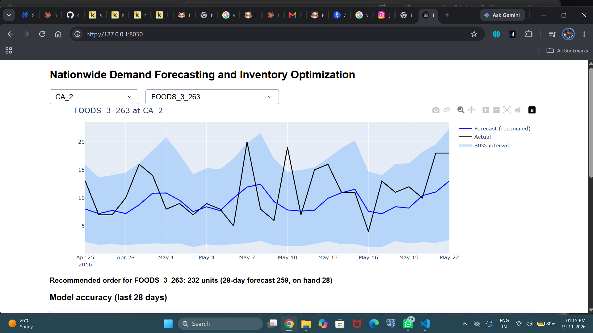
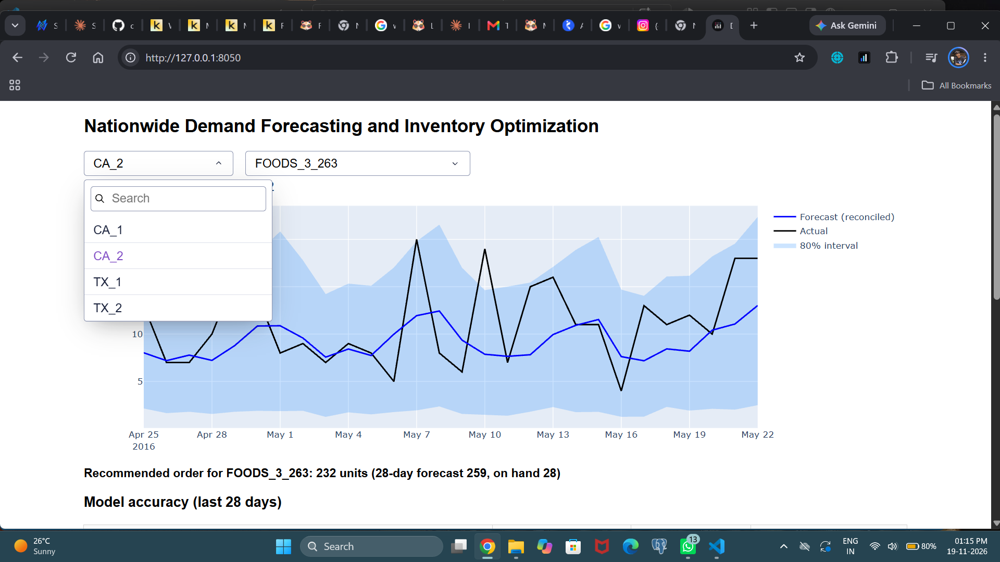
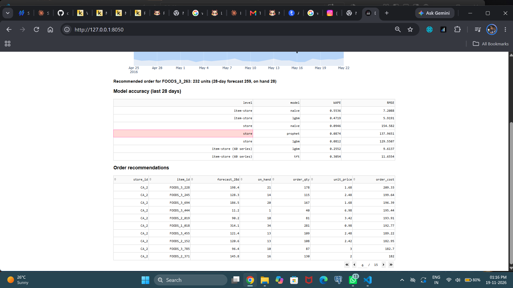

# DS-02: Nationwide Demand Forecasting and Inventory Optimization


An end-to-end forecasting and ordering system built on Walmart's M5 sales data. It forecasts daily product demand for several stores, makes the store, state and total forecasts consistent with each other, attaches prediction intervals, converts the forecasts into order quantities with a solver, and shows everything in an interactive Plotly Dash app.

---

## 1. Problem statement

A retailer with many stores has to decide, for every product and store, how much stock to order. Two things go wrong:

- **Ordering too little** causes stockouts and lost sales.
- **Ordering too much** causes waste and holding cost.

Point forecasts alone don't solve this. A planner also needs to know how uncertain the forecast is, and the forecasts at store, state and national level must agree with each other, otherwise different teams plan against different numbers.

**Goal:** forecast demand across stores, quantify the uncertainty, reconcile the hierarchy, and turn the forecasts into recommended order quantities that minimise stockout and holding cost under a capacity constraint.

## 2. What this app does against the problem statement

| Requirement | What the project delivers |
|---|---|
| Understand the item, store, state hierarchy | M5 data filtered to 4 stores (CA_1, CA_2, TX_1, TX_2) and the top 150 items, giving 600 item-store series |
| Features: lags, rolling averages, holidays, prices, promotions | Lag, rolling-mean, calendar, holiday, SNAP, price and promo-flag features (section 6) |
| Baselines, then LightGBM and a deep model | Seasonal naive, Prophet, LightGBM, Temporal Fusion Transformer (PyTorch Forecasting) |
| Reconcile store totals with regional totals | Hierarchical reconciliation with Darts (MinT) across store, state and total |
| Prediction intervals, not just point forecasts | 80% intervals from LightGBM quantile models and from the TFT quantile loss |
| Order quantities that minimise stockout and holding cost | OR-Tools linear program per store over three demand scenarios |
| Plotly Dash app with charts, WAPE, RMSE and order recommendations | `app/app.py` |

## 3. Tools and technologies

| Area | Tool |
|---|---|
| Language and environment | Python 3.11, virtual environment (`.venv`), VS Code |
| Data handling | pandas, NumPy, PyArrow (Parquet) |
| Baseline models | Seasonal naive, Prophet |
| Machine learning | LightGBM (Tweedie and quantile objectives) |
| Deep learning | PyTorch, PyTorch Forecasting (Temporal Fusion Transformer), Lightning |
| Reconciliation | Darts (`MinTReconciliator`) |
| Optimization | Google OR-Tools (GLOP linear solver) |
| Dashboard | Plotly, Dash |
| Version control | Git, GitHub |

## 4. Architecture



**Hierarchy used for reconciliation**

```
            Total
           /     \
         CA       TX
        /  \     /  \
    CA_1  CA_2 TX_1  TX_2
      (each store holds 150 items)
```

## 5. Project structure

```
churn_clv_system/                 (repository root)
├── README.md                     root index of both projects
├── .gitignore                    ignores data/, .venv/, lightning_logs/
├── DS-01/                        Customer Lifetime Value and Churn project
└── DS-02/                        this project
    ├── README.md                 this file
    ├── requirements.txt          pinned dependencies
    ├── data/                     raw M5 CSVs and processed.parquet (not committed)
    ├── src/
    │   ├── data_prep.py          subset, merge, feature engineering
    │   ├── models.py             naive, Prophet, LightGBM, intervals, metrics
    │   ├── tft.py                Temporal Fusion Transformer with quantile loss
    │   └── reconcile_orders.py   Darts reconciliation and OR-Tools ordering
    ├── app/
    │   └── app.py                Plotly Dash application
    ├── results/
    │   ├── metrics.csv
    │   ├── forecasts.parquet
    │   ├── forecasts_reconciled.parquet
    │   ├── prophet_store.parquet
    │   ├── tft_forecasts.parquet
    │   ├── reconciled_hierarchy.csv
    │   └── orders.csv
    └── docs/                     screenshots and architecture image
```

## 6. Workflow

1. **Data selection (`data_prep.py`).** Load `sales_train_evaluation.csv`, keep stores CA_1, CA_2, TX_1 and TX_2 and the 150 best-selling items, and keep the last 730 days. Reshape from wide to long format. The result is 438,000 rows (600 series x 730 days) from 2014-05-24 to 2016-05-22.
2. **Merge and feature engineering.** Join the calendar and weekly prices, then build:
   - price features, with forward and backward filling per series;
   - a promotion flag (price more than 5% below its trailing 28-day maximum);
   - a SNAP indicator for the store's state and a holiday flag;
   - lag and rolling-mean features, all shifted so no future sales leak in.
3. **Validation split (`models.py`).** The last 28 days are held out. Model features use lags of 28 days or more, so a 28-day-ahead forecast never sees sales from inside the forecast window.
4. **Models.**
   - Seasonal naive: the same weekday from the last training week.
   - Prophet: one model per store.
   - LightGBM: a Tweedie point model plus 10% and 90% quantile models, which give an 80% prediction interval.
   - Temporal Fusion Transformer (`tft.py`): quantile loss at 10%, 50% and 90%.
5. **Reconciliation (`reconcile_orders.py`).** Prophet store forecasts and LightGBM state and total forecasts are combined into one hierarchy. Darts MinT reconciliation (`wls_struct`) makes them add up exactly. The reconciled store totals are then pushed down to item level.
6. **Order optimization.** For each store, OR-Tools solves a linear program that picks an order quantity per item (section 8).
7. **Dashboard (`app/app.py`).** Reads the saved results and shows forecasts, intervals, accuracy and orders.

## 7. Results

All figures are on the held-out last 28 days (2016-04-25 to 2016-05-22).

### Forecast accuracy

| Level | Model | WAPE | RMSE |
|---|---|---|---|
| Item-store (600 series) | Seasonal naive | 0.5536 | 7.21 |
| Item-store (600 series) | **LightGBM** | **0.4719** | **5.92** |
| Store (4 series) | Seasonal naive | 0.0946 | 154.58 |
| Store (4 series) | Prophet | 0.0874 | 137.97 |
| Store (4 series) | **LightGBM** | **0.0812** | **129.55** |
| Item-store (60 top series) | LightGBM | 0.2552 | 9.61 |
| Item-store (60 top series) | TFT | 0.3054 | 11.66 |

### Prediction intervals

| Model | Nominal coverage | Observed coverage |
|---|---|---|
| LightGBM quantile (p10 to p90) | 80% | 81.7% |
| TFT quantile (p10 to p90) | 80% | 76.0% |

### Reconciliation

| Measure | Before | After |
|---|---|---|
| Store WAPE | 0.0874 | 0.0860 |
| State WAPE | 0.0736 | 0.0699 |
| Gap between CA store sum and CA state forecast (max over days) | 190.67 units | 0.000000 |
| Item-level WAPE | 0.4719 | 0.4729 |

### Order recommendations (28-day horizon)

| Store | 28-day forecast (units) | Order quantity (units) | Order cost |
|---|---|---|---|
| CA_1 | 36,844 | 34,609 | 52,526 |
| CA_2 | 28,925 | 27,188 | 41,243 |
| TX_1 | 29,591 | 27,815 | 40,626 |
| TX_2 | 37,842 | 35,551 | 52,951 |

Example from the app: FOODS_3_263 at CA_2 has a 28-day forecast of 259 units and 28 units on hand, so the recommended order is 232 units.

## 8. Order optimization model

For every store, one linear program is solved with the GLOP solver in OR-Tools.

- **Decision:** order quantity `q` for each item.
- **Demand scenarios:** low (reconciled p10), medium (reconciled forecast) and high (reconciled p90), weighted 25%, 50% and 25%.
- **Objective:** minimise the weighted expected cost of
  - *overstock* units, charged a holding cost, and
  - *shortage* units, charged the lost margin.
- **Constraint:** total units ordered by a store cannot exceed 105% of that store's net need (forecast minus stock on hand).

**Assumptions (the M5 data has no inventory or cost data, so these are modelling choices):**

| Assumption | Value |
|---|---|
| Stock on hand | 3 days of forecast demand per item |
| Unit cost | 70% of the selling price |
| Holding cost | 10% of unit cost over the horizon |
| Shortage cost | Lost margin (price minus unit cost) |
| Store capacity | 105% of net need |

These values are inputs, not findings. Replace them with real figures if they are available.

## 9. What the results tell us

- **LightGBM is the best forecaster here.** It beats the seasonal naive baseline by about 15% in WAPE at item level (0.472 vs 0.554), and beats both naive and Prophet at store level (0.081 vs 0.095 and 0.087).
- **Store-level forecasts are far more accurate than item-level ones.** Store WAPE is about 8%, item WAPE about 47%. Daily sales of a single item are small, intermittent numbers, so noise dominates. Aggregating averages the noise out. Planning decisions should lean on aggregated forecasts where possible.
- **The small TFT did not beat LightGBM.** On the same 60 series TFT's WAPE was 0.305 against 0.255. The TFT was trained on CPU for 5 short epochs on a subset, and tree models are very strong on M5. The TFT still provides calibrated quantile intervals (76% observed coverage for an 80% interval).
- **The intervals are usable.** In the dashboard most actual sales fall inside the 80% band, which is the information a planner needs to size safety stock. Sharp one-day spikes sit above the forecast line and, in some cases, above the band.
- **Reconciliation makes the numbers consistent without hurting accuracy.** The mismatch between store and state forecasts fell from 190.67 units to zero. Store and state WAPE both improved slightly, and item-level WAPE was essentially unchanged (0.4719 to 0.4729).
- **Orders track forecasts closely.** Each store's recommended order is about 94% of its 28-day forecast, the rest being covered by assumed on-hand stock. High-volume, higher-priced items drive most of the order cost, so they are where accuracy matters most.

## 10. Challenges and how they were handled

| Challenge | Handling |
|---|---|
| Very large raw data (about 1.2 GB of CSV) | Worked on a 4-store, 150-item, 730-day subset and saved processed data as Parquet |
| Sparse, intermittent item demand gives a high item-level error | Used Tweedie loss in LightGBM; reported WAPE alongside RMSE; relied on aggregated levels for planning |
| Avoiding data leakage | All features use lags of 28 days or more relative to the forecast window; the last 28 days are held out |
| Different models produce incoherent forecasts at different levels | Darts MinT reconciliation over the store, state and total hierarchy |
| No GPU available | Small TFT (60 series, 365 days, hidden size 16, 5 epochs) trained on CPU |
| Prophet is slow on hundreds of series | Fitted Prophet at store level only |
| No inventory or cost data in M5 | Stated explicit, adjustable assumptions for stock on hand and costs |
| Environment problems: Python 3.13 compatibility, dropped downloads, packages installed outside the virtual environment, pandas 3.x | Used Python 3.11, installed with `python -m pip` inside the venv with retries, pinned `pandas<3` |

## 11. Limitations and next steps

- Accuracy is measured on a single 28-day hold-out. Rolling-origin cross-validation would give a more reliable estimate.
- The subset covers 4 stores in 2 states. The code scales to the full dataset with more compute, and a GPU would allow a properly trained TFT.
- Order quantities use assumed stock levels and costs, and a single ordering period.
- Reconciliation uses store, state and total levels. Department and category levels could be added.
- Possible extensions: hyperparameter tuning, a longer TFT training run, forecast ensembling, and deployment on Render, Vercel or a similar host.

## 12. How to run

**Requirements:** Python 3.11 and the three Kaggle files from the *M5 Forecasting - Accuracy* competition.

```powershell
# from the repository root
cd DS-02
py -3.11 -m venv .venv
.venv\Scripts\activate
python -m pip install -r requirements.txt
```

Place `calendar.csv`, `sales_train_evaluation.csv` and `sell_prices.csv` in `DS-02/data/`, then run the pipeline in order:

```powershell
python src\data_prep.py          # builds data\processed.parquet
python src\models.py             # naive, Prophet, LightGBM, metrics, intervals
python src\tft.py                # Temporal Fusion Transformer (CPU, a few minutes)
python src\reconcile_orders.py   # reconciliation and order optimization
python app\app.py                # dashboard at http://127.0.0.1:8050
```

To compute the LightGBM interval coverage for the table in section 7:

```powershell
python -c "import pandas as pd; d=pd.read_parquet('results/forecasts.parquet'); print(((d.sales>=d.lgbm_p10)&(d.sales<=d.lgbm_p90)).mean())"
```

## 13. Dashboard screenshots

Save screenshots in `docs/` with these names and they will display here.






## 14. Data source

M5 Forecasting - Accuracy, Walmart sales data, published on Kaggle.
